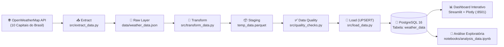

# 🌤️ Pipeline ETL & Dashboard Climático — Capitais do Brasil

Projeto completo de **Engenharia de Dados de ponta a ponta**: extrai dados meteorológicos em tempo real de **10 capitais brasileiras** (nas 5 regiões do país) via API da OpenWeatherMap, aplica limpeza, padronização e validações de **Data Quality** com **Python/Pandas**, armazena de forma idempotente (**UPSERT**) no **PostgreSQL**, orquestra execuções horárias com **Apache Airflow** e disponibiliza análises interativas em um **Dashboard Streamlit + Plotly** e **Jupyter Notebook** — tudo containerizado com **Docker Compose**.

> Projeto evoluído a partir da base do tutorial de [@vbluuiza](https://github.com/vbluuiza/pipeline_etl_weather_data_tutorial_youtube), expandido com coleta multi-capitais, camada de Data Quality, carga idempotente sem duplicatas e dashboard analítico em tempo real.

---

## 🏗️ Arquitetura de Dados



*(Orquestrado automaticamente a cada 1 hora pelo **Apache Airflow 3.1.7** na porta `:8080`)*

---

## ✨ Diferenciais de Engenharia Implementados

- **Coleta Nacional Multi-Cidades:** Monitoramento simultâneo de 10 capitais cobrindo Norte, Nordeste, Centro-Oeste, Sudeste e Sul (São Paulo, Rio de Janeiro, Belo Horizonte, Curitiba, Porto Alegre, Brasília, Salvador, Recife, Fortaleza e Manaus).
- **Idempotência com `UPSERT` (`ON CONFLICT DO UPDATE`):** Chave primária composta `(city_id, datetime)` no PostgreSQL garantindo zero duplicidade mesmo em reexecuções manuais ou *retries* do Airflow.
- **Proteção contra *Schema Drift*:** Tratamento de campos sazonais da API (como `rain.1h` em dias de chuva ou `wind.gust`) mantendo o esquema relacional consistente.
- **Camada dedicada de *Data Quality* (`src/quality_checks.py`):** Validação automática de nulos, duplicatas em lote e limites físicos realistas de temperatura (`-50 °C` a `60 °C`) e umidade (`0%` a `100%`) antes da escrita no banco.
- **Dashboard Analítico Containerizado (`dashboard/app.py`):** Mapa interativo do Brasil, comparativo de Temperatura Real vs. Sensação Térmica, correlações regionais, série histórica e exportação para CSV.

---

## 🛠️ Stack Tecnológica

| Camada | Tecnologias |
|---|---|
| **Linguagem & Dados** | Python 3.12/3.13, Pandas, PyArrow (Parquet) |
| **Banco de Dados** | PostgreSQL 16, SQLAlchemy, Psycopg2 |
| **Orquestração** | Apache Airflow 3.1.7 (CeleryExecutor + Redis) |
| **Visualização & EDA** | Streamlit, Plotly, Matplotlib, Seaborn, Jupyter Notebook |
| **Infraestrutura** | Docker & Docker Compose |

---

## 🚀 Como Executar o Projeto

### 1. Pré-requisitos
- **Docker Desktop** instalado e em execução
- Chave gratuita da [OpenWeatherMap API](https://openweathermap.org/api)

### 2. Configurar Variáveis de Ambiente
Copie o arquivo `config/.env.example` para `config/.env` e adicione sua chave da API:

```env
API_KEY=sua_chave_openweathermap_aqui
user=airflow
password=airflow
database=airflow
host=localhost
port=5433
```

### 3. Subir Todos os Serviços com Docker
```powershell
docker compose up -d --build
```

### 4. Acessar as Interfaces
- **Apache Airflow (Orquestrador):** http://localhost:8080 *(login: `airflow` / `airflow`)*
- **Dashboard Climático (Streamlit):** http://localhost:8501
- **PostgreSQL (Acesso externo):** `localhost:5433` *(banco: `airflow`, tabela: `weather_data`)*

### 5. Desligar o Ambiente
```powershell
docker compose down
```

---

## 📂 Estrutura de Pastas

```text
├── config/
│   └── .env.example          # Modelo de variáveis de ambiente
├── dags/
│   └── weather_dag.py        # DAG do Airflow (extract >> transform >> quality_check >> load)
├── dashboard/
│   ├── Dockerfile            # Imagem Docker do Dashboard
│   └── app.py                # Aplicação interativa em Streamlit + Plotly
├── data/                     # Camada de armazenamento local (JSON bruto e Parquet temporário)
├── notebooks/
│   └── analysis_data.ipynb   # Notebook de Análise Exploratória de Dados (EDA)
├── src/
│   ├── extract_data.py       # Extração multi-capitais via API REST
│   ├── transform_data.py     # Limpeza, normalização e fuso horário
│   ├── quality_checks.py     # Regras de validação e qualidade dos dados
│   └── load_data.py          # Modelagem da tabela e UPSERT no PostgreSQL
├── Dockerfile                # Imagem customizada do Airflow com Pandas/PyArrow
├── docker-compose.yaml       # Orquestração dos containers (Postgres, Redis, Airflow, Streamlit)
├── main.py                   # Executor local do pipeline completo
└── requirements.txt          # Dependências do ambiente virtual Python
```
